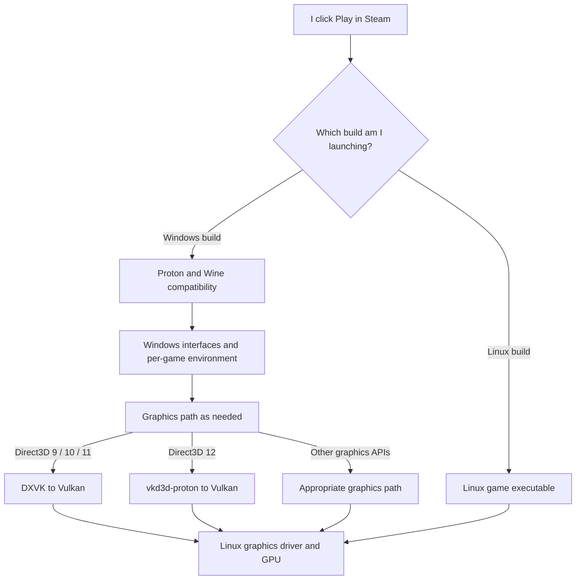

# I learned how Steam runs Windows games

Once Steam opened, I had another question: if a downloaded game was built for Windows, how could clicking **Play** work on Ubuntu?

I had to correct the premise first. Steam does not guarantee that every game will run after downloading. A game without a native Linux version may still work through Proton, while a game that downloads correctly can still fail at launch or during gameplay. [Valve's Proton support documentation](https://partner.steamgames.com/doc/store/application/platforms/linux/proton)

## I separated the two paths

| Game build | What I would launch on Ubuntu |
| --- | --- |
| Native Linux build | The game's Linux executable, with its Linux dependencies |
| Windows build with Proton | The Windows executable through Proton's compatibility components |
| Windows build incompatible with Proton | No guaranteed working launch; downloading does not fix incompatibility |

I learned that Proton integrates with Steam and uses Wine to run Windows games on Linux. I would normally use the Proton version provided by Steam rather than build Proton or install a separate system Wine just for this workflow. [Valve's Proton project](https://github.com/ValveSoftware/Proton)

## I followed the launch sequence

My simplified model is:

1. I install the selected game build into a Steam library.
2. For a Windows build, Steam obtains the selected Proton tool if it is not already available.
3. When I click Play, Steam launches the game through that compatibility tool and its runtime environment.
4. Proton supplies Windows-compatible interfaces and a per-game Wine environment.
5. Graphics components handle the game's graphics API where applicable, with my Linux graphics driver still doing the hardware work.

This is an explanatory model, not a trace captured from Business Tour. Valve describes Proton as the bridge for Windows executables; its source documentation also explains Steam-provided tool versions. [Valve's compatibility overview](https://partner.steamgames.com/doc/steamdeck/compat) · [Proton README](https://github.com/ValveSoftware/Proton)



I am not saying every game uses DirectX or that every call takes the same route. This diagram deliberately leaves out many runtime details.

## I understood Wine's role

I stopped imagining that Steam recompiles or permanently converts a Windows `.exe` into a Linux executable. Proton uses Wine-based compatibility so the program can find Windows interfaces it expects while running in a Linux environment; it is not a complete Windows virtual machine. [Valve's Proton documentation](https://partner.steamgames.com/doc/steamhardware/proton) · [Valve's execution overview](https://partner.steamgames.com/doc/steamdeck/compat)

That explains why I can run some Windows-only releases without installing Windows. It does not mean every Windows feature or driver is supported.

## I traced the graphics path

I learned to distinguish the Windows game interface from the graphics interface:

| Component | Role I learned |
| --- | --- |
| DXVK | Implements Direct3D 9/10/11, among its supported versions, using Vulkan. [DXVK project](https://github.com/doitsujin/dxvk) |
| vkd3d-proton | Implements Direct3D 12 on Vulkan. [vkd3d-proton project](https://github.com/HansKristian-Work/vkd3d-proton/) |
| Linux GPU driver | Supplies the actual Linux-side graphics support; translation does not make an unsupported GPU or driver sufficient. [vkd3d-proton driver requirements](https://github.com/HansKristian-Work/vkd3d-proton/) |

I would let Steam's Proton distribution manage these components instead of manually dropping DLLs into an online game. I am documenting their purpose, not recommending separate installation or multiplayer modifications.

## I found the per-game environment

I learned that Proton normally creates a separate Wine prefix for each game under the same library:

```text
<SteamLibrary>/steamapps/compatdata/<APPID>/pfx/
```

I think of that prefix as the game's Windows-style environment, containing its drive layout and settings. Valve documents this per-game directory layout in its [Proton FAQ](https://github.com/ValveSoftware/Proton/wiki/Proton-FAQ/74cc0a33c45974ce20be376061a63e02905976bf).

I distinguish it from the main game files:

```text
<SteamLibrary>/steamapps/common/<game-directory>/
```

I would not delete `compatdata` as a casual troubleshooting step: it may hold game settings and local saves. I would back up my library and saves first, rather than assume everything is in Steam Cloud.

## I understood the limits

I cannot turn unsupported anti-cheat into working anti-cheat by selecting a different checkbox. Valve documents per-title developer configuration for some anti-cheat systems and limitations around kernel-space solutions. [Valve's anti-cheat guidance](https://partner.steamgames.com/doc/steamhardware/proton)

Other compatibility gaps, launchers and DRM can also cause trouble. I would check current reports and then test my actual game, hardware, driver and Proton version; a successful menu launch would still not prove that online play or a full session works. [Valve's known issues](https://partner.steamgames.com/doc/steamhardware/proton)

## I separated two different fixes

My AppArmor change allowed Steam's runtime helper to perform the namespace operations it needed. Proton addresses Windows-game compatibility. I did not mistake solving the first problem for proof that I had solved the second.

Next: [I planned the Business Tour test](07-installing-and-checking-business-tour.md).
